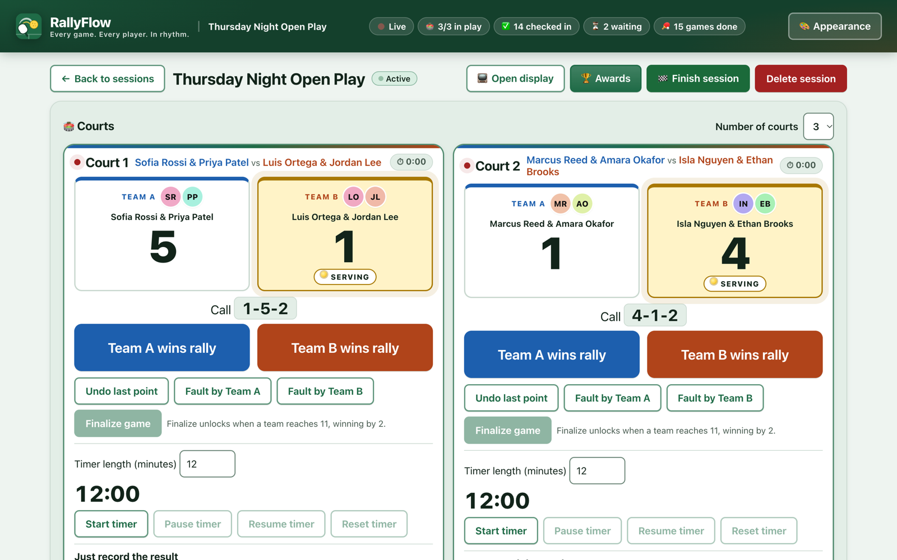
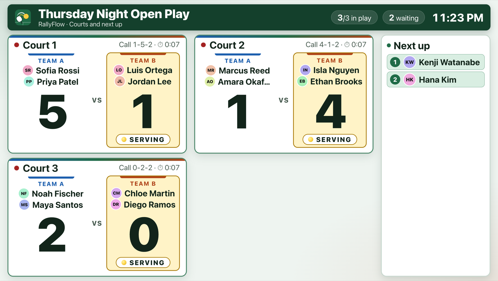
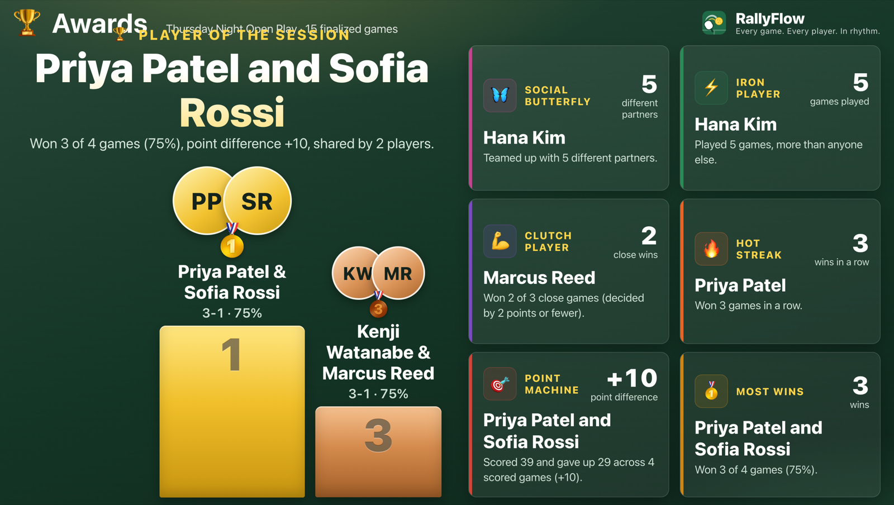
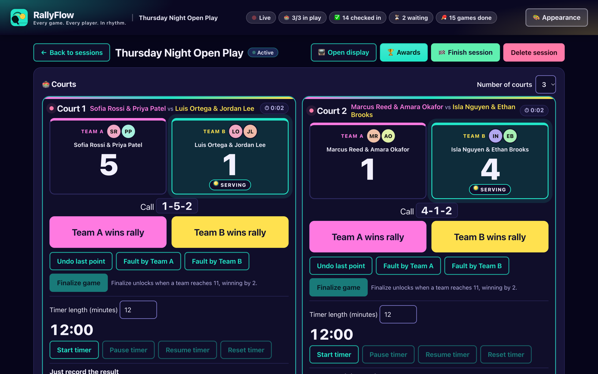
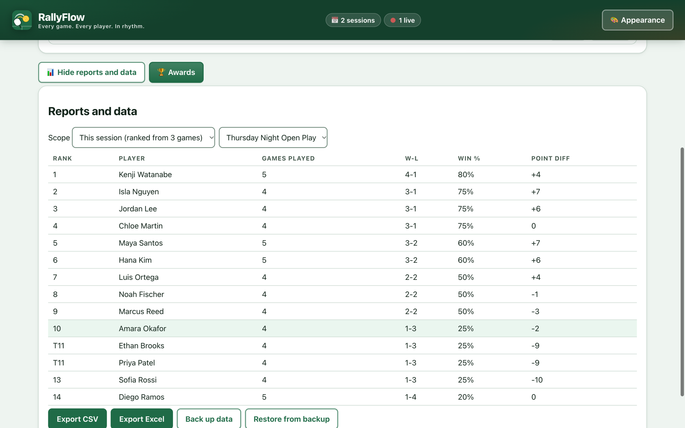
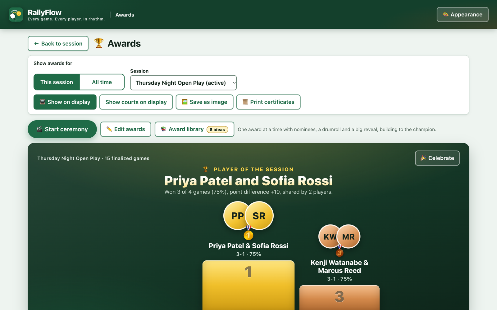
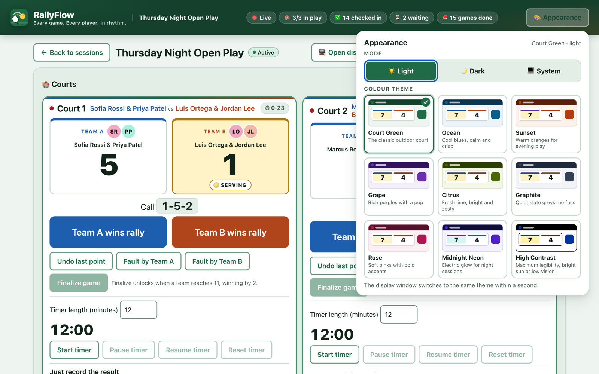

<p align="center">
  
</p>

<p align="center"><strong>Offline Pickleball Open Play Manager</strong> for macOS and Windows</p>

<p align="center">
  
</p>

## What it is

RallyFlow runs a pickleball open-play night from one laptop. It decides who plays next so everyone gets fair court time, scores every rally with the official rules, shows courts and the queue on a big screen for the players, and ends the night with an awards ceremony. It is built for one organizer with 16–32 players on 2–4 courts, and it works entirely offline: no accounts, no cloud, no tracking.

## Features

- **Fair rotation** — recommends the next game for every free court: longest-waiting players first, mixed partners and opponents, nobody sits out twice in a row. One click: **Start this game**.
- **Rally-by-rally scoring, official rules** — side-outs, server number and the called score ("4-1-2"), faults, one-tap undo and audited corrections. Or just record the final score.
- **Game timer** — per court, with pause/resume; expiry is only a signal and never ends a game.
- **Big-screen display** — a read-only second window for a TV or projector: every court, score, server and who's next, updating live.
- **Awards ceremony** — Player of the Session, podium, Hot Streak, Point Machine, Dynamic Duo, Clutch Player, Social Butterfly and more; show on the display, save as an image or print certificates.
- **Reports** — per-session and all-time leaderboards.
- **Themes** — nine colour themes (Court Green, Ocean, Sunset, Grape, Citrus, Graphite, Rose, Midnight Neon, High Contrast) in light, dark or system mode; the display follows.
- **Offline & private** — all data stays in a local SQLite database; the app blocks every network request.
- **Backup & export** — one-file backups with validated restore and automatic safety backups; CSV and Excel export.
- **Crash-safe** — every action is saved as it happens; an unfinished session can be resumed.

## Screenshots

| Big-screen display | Awards ceremony |
| --- | --- |
|  |  |
| **Dark mode (Midnight Neon)** | **Reports and leaderboard** |
|  |  |
| **Awards page** | **Appearance picker** |
|  |  |

## Download and install

Get the latest installers from this repository's **Releases** page (`/releases/latest`):

| Your computer | Download |
| --- | --- |
| Mac with Apple silicon (M1–M4), macOS 13+ | `RallyFlow-<version>-arm64.dmg` |
| Mac with Intel, macOS 13+ | `RallyFlow-<version>-x64.dmg` |
| Windows 10 (22H2) or Windows 11 | `RallyFlow-Setup-<version>.exe` |

The installers are not code-signed yet, so the first launch needs one extra click:

- **Mac:** drag RallyFlow into Applications, Control-click it and choose **Open**, then **Open** again. If it is still blocked: System Settings › Privacy & Security › **Open Anyway**.
**"RallyFlow is damaged and can't be opened" (Mac, version 1.1.0 only):** download 1.1.1 or newer. Or open Terminal and run `xattr -cr /Applications/RallyFlow.app`, then open RallyFlow again.
- **Windows:** when SmartScreen shows "Windows protected your PC", click **More info** › **Run anyway**.

Full instructions: [docs/INSTALL.md](docs/INSTALL.md).

## First run

1. Type a **Session name** (for example "Thursday Night Open Play"), pick **Courts** (2–4) and press **Start session**.
2. Add players with **Player name** › **Add player**, and press **Check in** as they arrive.
3. Press **Start this game** for each free court, then score with **Team A wins rally** / **Team B wins rally**.
4. Press **Open display** to put the courts and queue on a second screen.
5. At the end, open **Awards**, put the ceremony on the display, and **Finish session**. Make a backup.

The full organizer guide is in [docs/USER_GUIDE.md](docs/USER_GUIDE.md).

## Build from source

Requirements: Node.js 20+ (22 recommended), macOS or Windows.

```
npm ci
npm run dev                 # run the app in development
npm run typecheck           # TypeScript
npx vitest run              # unit + integration tests
npm run e2e                 # build, then Playwright drives the real Electron app
npm run dist:mac            # Apple silicon DMG + zip in release/ (offline, unsigned)
npm run install-app         # macOS: build and install RallyFlow.app into ~/Applications
npm run icons               # regenerate build/icon.* from build/icon.svg
npm run screenshots         # regenerate site/assets/screenshots/*.png with sample data
npm run notices             # regenerate THIRD_PARTY_NOTICES.md
```

Releases for all platforms are built by GitHub Actions when a `v*` tag is pushed — see [docs/RELEASING.md](docs/RELEASING.md). The website in `site/` is published to GitHub Pages by `.github/workflows/pages.yml`. Sharing tips and ready-to-post copy: [docs/SHARE_KIT.md](docs/SHARE_KIT.md).

## Tech stack

Electron + React + TypeScript, built with electron-vite; SQLite through better-sqlite3; Excel export with exceljs; Vitest for unit/integration tests and Playwright for end-to-end tests; electron-builder for DMG/zip/NSIS installers. The scoring, rotation, stats and awards engines in `src/core` are pure TypeScript with no I/O.

## Privacy

RallyFlow stores all data locally on your device and makes no network requests. There is no analytics or telemetry; backups and exports are files you control. See [PRIVACY.md](PRIVACY.md).

## Licence

Copyright © 2026 RallyFlow. All rights reserved. RallyFlow is proprietary software: see [LICENSE](LICENSE) and the end-user licence in [EULA.md](EULA.md). Open-source components are listed with their licences in [THIRD_PARTY_NOTICES.md](THIRD_PARTY_NOTICES.md).
